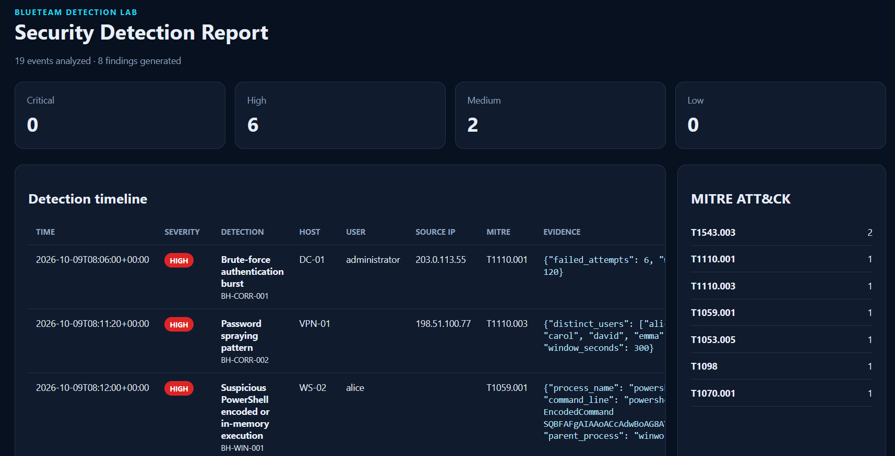
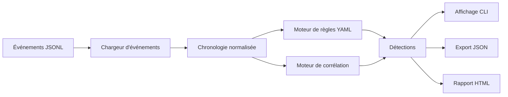

<div align="center">


# BlueTeam Detection Lab

### Detection Engineering · Threat Hunting · SOC · DFIR · MITRE ATT&CK

Laboratoire défensif en Python permettant d'analyser des événements de sécurité, de corréler des comportements suspects et de produire des détections exploitables par un analyste SOC.


</div>

---

## Présentation

**BlueTeam Detection Lab** est un projet de cybersécurité défensive centré sur le **Detection Engineering**, le **Threat Hunting** et l'analyse d'événements de sécurité.

Le moteur lit des événements normalisés au format **JSONL**, reconstruit leur chronologie, applique des règles de détection décrites en YAML, exécute des corrélations temporelles puis génère des alertes enrichies avec leur niveau de sévérité et leur correspondance **MITRE ATT&CK**.

L'objectif est de montrer concrètement le fonctionnement interne d'une chaîne de détection sans dépendre d'un SIEM complet comme Splunk, Elastic ou Microsoft Sentinel.

## Aperçu du rapport

<p align="center">
  
</p>

Le rapport HTML regroupe les détections par niveau de sévérité, affiche leur chronologie, les hôtes et utilisateurs concernés, les adresses IP sources, les preuves associées ainsi qu'un résumé des techniques **MITRE ATT&CK** observées dans l'analyse.

---

Le pipeline général est le suivant :

```text
Événements de sécurité
        │
        ▼
Lecture du JSONL
        │
        ▼
Normalisation + chronologie
        │
        ├─────────────────┐
        ▼                 ▼
Règles YAML       Corrélation temporelle
        │                 │
        └────────┬────────┘
                 ▼
             Détections
                 │
        ┌────────┴────────┐
        ▼                 ▼
      JSON          Rapport HTML
```

---

## Objectifs du projet

Un outil SOC ne se limite pas à afficher des alertes. Une détection pertinente suppose de comprendre :

- quelles données sont nécessaires ;
- comment reconnaître un comportement suspect ;
- comment distinguer un événement isolé d'une séquence malveillante ;
- comment corréler plusieurs événements dans une fenêtre de temps ;
- comment associer une alerte à une technique MITRE ATT&CK ;
- comment présenter suffisamment de preuves pour permettre une investigation.

Ce projet implémente volontairement ces mécanismes à petite échelle afin de rendre chaque étape lisible dans le code.

Il complète des projets orientés sécurité Web ou réseau avec une composante dédiée à la **Blue Team**, au **SOC**, au **Threat Hunting** et au **DFIR**.

---

## Fonctionnalités

Le projet permet actuellement de :

- charger des événements de sécurité depuis un fichier JSONL ;
- vérifier et ordonner leur chronologie ;
- appliquer des règles de détection statiques écrites en YAML ;
- corréler plusieurs événements dans une fenêtre temporelle ;
- filtrer les résultats selon leur sévérité ;
- associer les détections à des techniques MITRE ATT&CK ;
- afficher les résultats directement dans le terminal ;
- exporter les détections en JSON ;
- générer un rapport HTML autonome ;
- exécuter des tests automatisés sur le dataset de démonstration.

---

## Catalogue des détections

Le dataset fourni permet de déclencher huit scénarios de détection.

| Détection | Type | Sévérité | MITRE ATT&CK |
| --- | --- | ---: | --- |
| Rafale de tentatives d'authentification | Corrélation | Élevée | `T1110.001` Password Guessing |
| Password spraying | Corrélation | Élevée | `T1110.003` Password Spraying |
| PowerShell encodé ou exécuté en mémoire | Règle YAML | Élevée | `T1059.001` PowerShell |
| Effacement du journal de sécurité Windows | Règle YAML | Élevée | `T1070.001` Clear Windows Event Logs |
| Création d'une tâche planifiée | Règle YAML | Moyenne | `T1053.005` Scheduled Task |
| Ajout d'un compte à un groupe privilégié | Règle YAML | Élevée | `T1098` Account Manipulation |
| Installation d'un nouveau service Windows | Règle YAML | Moyenne | `T1543.003` Windows Service |
| Service exécuté depuis un chemin modifiable par l'utilisateur | Règle YAML | Élevée | `T1543.003` Windows Service |

Les références ATT&CK indiquent la technique représentée par chaque scénario du laboratoire. Elles ne signifient pas que le moteur couvre l'intégralité de ces techniques dans un environnement d'entreprise.

---

## Corrélation temporelle

Certaines attaques ne peuvent pas être identifiées à partir d'un seul événement. Elles nécessitent de regrouper plusieurs événements et d'observer leur fréquence.

### Brute force

Le moteur suit les échecs d'authentification à partir de la combinaison :

```text
hôte + utilisateur + adresse IP source
```

Une détection est créée lorsqu'au moins **6 échecs** sont observés en moins de **120 secondes** pour la même combinaison.

Cette logique permet de détecter des tentatives répétées contre un même compte sans considérer quelques erreurs de mot de passe isolées comme une attaque.

### Password spraying

Le password spraying possède un profil différent : une même source tente généralement un faible nombre de mots de passe sur **plusieurs comptes**.

Le moteur regroupe donc les événements selon :

```text
hôte + adresse IP source
```

Une détection est créée lorsqu'au moins **5 utilisateurs distincts** sont ciblés en moins de **300 secondes**.

Cette différence explique pourquoi ces scénarios sont gérés par un moteur de corrélation séparé des règles YAML statiques.

---

## Règles YAML

Les règles statiques se trouvent dans le dossier [`rules/`](rules/).

Elles utilisent un format volontairement simple afin de garder la logique facile à lire et à étendre.

Exemple :

```yaml
id: BH-WIN-001
title: Suspicious PowerShell encoded or in-memory execution
severity: high
mitre:
  tactic: Execution
  technique: T1059.001
match:
  all:
    - field: process_name
      op: regex
      value: '(?i)(powershell|pwsh)(\.exe)?$'
    - field: command_line
      op: regex
      value: '(?i)(-enc(odedcommand)?\b|frombase64string|invoke-expression|\biex\b)'
```

Les opérateurs disponibles sont :

```text
equals
contains
regex
in
exists
```

Le format est **inspiré de Sigma**, mais il ne cherche pas à être une implémentation complète du standard Sigma.

---

## Format des événements

Le moteur attend un objet JSON par ligne.

Exemple d'événement d'authentification :

```json
{
  "timestamp": "2026-10-09T08:05:00Z",
  "host": "DC-01",
  "event_id": "4625",
  "category": "authentication",
  "status": "failed",
  "user": "administrator",
  "src_ip": "203.0.113.55"
}
```

Les événements liés aux processus ou à la persistance peuvent également utiliser des champs comme :

```text
process_name
parent_process
command_line
task_name
service_name
image_path
target_group
member_name
```

Le choix d'un schéma normalisé permet de découpler le moteur de détection de la source réelle des journaux. Une évolution future pourrait ainsi convertir des événements Sysmon, EVTX, Zeek ou Suricata vers ce format commun.

---

## Architecture



Le package Python est séparé par responsabilités :

```text
src/bluehunt/
├── cli.py            interface en ligne de commande
├── loader.py         lecture et validation du JSONL
├── rules.py          chargement et évaluation des règles YAML
├── correlations.py   détections basées sur des fenêtres temporelles
├── engine.py         orchestration de l'analyse
├── models.py         modèles représentant les détections
├── report.py         exports JSON et HTML
└── utils.py          fonctions utilitaires et gestion du temps
```

---

## Structure du projet

```text
BlueTeam-Detection-Lab/
├── rules/
│   ├── admin_group_change.yml
│   ├── new_service.yml
│   ├── powershell_encoded.yml
│   ├── scheduled_task.yml
│   ├── suspicious_service_path.yml
│   └── windows_log_clear.yml
│
├── samples/
│   └── events.jsonl
│
├── src/
│   └── bluehunt/
│       ├── __init__.py
│       ├── __main__.py
│       ├── cli.py
│       ├── correlations.py
│       ├── engine.py
│       ├── loader.py
│       ├── models.py
│       ├── report.py
│       ├── rules.py
│       └── utils.py
│
├── tests/
│   └── test_engine.py
│
├── reports/
│   └── .gitkeep
│
├── .gitattributes
├── .gitignore
├── pyproject.toml
├── requirements.txt
├── run-demo.ps1
├── run-demo.sh
└── README.md
```

---

## Installation

### Prérequis

Le projet nécessite :

- **Python 3.11 ou supérieur** ;
- `pip`.

Vérification :

```bash
python --version
pip --version
```

### Cloner le dépôt

```bash
git clone https://github.com/ge-xe/BlueTeam-Detection-Lab.git
cd BlueTeam-Detection-Lab
```

### Créer un environnement virtuel

```bash
python -m venv .venv
```

Sous Windows PowerShell :

```powershell
.\.venv\Scripts\Activate.ps1
```

Sous Linux ou macOS :

```bash
source .venv/bin/activate
```

### Installer le projet

```bash
pip install -e .
```

La commande `bluehunt` devient alors disponible dans l'environnement virtuel.

---

## Utilisation

### Lancer une analyse simple

```bash
bluehunt analyze samples/events.jsonl
```

Le moteur charge les événements, exécute les règles et les corrélations puis affiche les détections directement dans le terminal.

Sur le dataset fourni, le résultat attendu est :

```text
19 événements analysés
8 détections
```

### Générer les rapports JSON et HTML

Sous Windows PowerShell :

```powershell
bluehunt analyze samples\events.jsonl --json reports\demo-findings.json --html reports\demo-report.html
```

Sous Linux ou macOS :

```bash
bluehunt analyze samples/events.jsonl \
  --json reports/demo-findings.json \
  --html reports/demo-report.html
```

Le rapport HTML peut ensuite être ouvert directement dans un navigateur :

```text
reports/demo-report.html
```

### Filtrer par sévérité

Exemple pour n'afficher que les détections de niveau élevé :

```bash
bluehunt analyze samples/events.jsonl --min-severity high
```

### Lister les règles statiques

```bash
bluehunt rules
```

---

## Démonstration en une commande

### Windows PowerShell

```powershell
.\run-demo.ps1
```

Le script :

1. crée l'environnement virtuel `.venv` s'il n'existe pas ;
2. l'active ;
3. met `pip` à jour ;
4. installe le projet ;
5. installe `pytest` ;
6. analyse le dataset de démonstration ;
7. génère le rapport JSON ;
8. génère le rapport HTML.

À la fin, ouvre :

```text
reports\demo-report.html
```

### Linux / macOS

```bash
chmod +x run-demo.sh
./run-demo.sh
```

---

## Dataset de démonstration

Le fichier [`samples/events.jsonl`](samples/events.jsonl) contient uniquement des **événements synthétiques**.

Il mélange volontairement de l'activité normale avec plusieurs comportements suspects :

- connexions légitimes ;
- échecs répétés sur un même compte ;
- password spraying sur plusieurs utilisateurs ;
- exécution PowerShell encodée ;
- création d'une tâche planifiée ;
- installation d'un service Windows ;
- service lancé depuis un emplacement modifiable par un utilisateur ;
- ajout d'un compte à un groupe privilégié ;
- effacement du journal de sécurité Windows.

Les plages d'adresses IP utilisées dans les exemples (`192.0.2.0/24`, `198.51.100.0/24` et `203.0.113.0/24`) sont des plages réservées à la documentation et ne représentent pas des machines réelles.

---

## Exemple de sortie

```text
SEVERITY  TIME                 RULE          HOST         USER         SOURCE IP       TITLE
----------------------------------------------------------------------------------------------------------------
HIGH      2026-10-09 08:06:00  BH-CORR-001   DC-01        administrator 203.0.113.55    Brute-force authentication burst
HIGH      2026-10-09 08:11:20  BH-CORR-002   VPN-01                    198.51.100.77   Password spraying pattern
HIGH      2026-10-09 08:12:00  BH-WIN-001    WS-02        alice                         Suspicious PowerShell encoded or in-memory execution
```

Les intitulés affichés par le moteur restent actuellement en anglais afin de conserver des noms de règles concis et facilement comparables avec la terminologie utilisée dans les outils de sécurité.

---

## Tests

Installer `pytest` si nécessaire :

```bash
pip install pytest
```

Puis exécuter :

```bash
pytest -q
```

Le test fourni vérifie que le dataset contient bien **19 événements** et que les huit scénarios attendus sont détectés.

---

## Ajouter une règle

Pour ajouter une nouvelle détection simple, il suffit de créer un fichier YAML dans `rules/`.

Exemple de structure :

```yaml
id: BH-CUSTOM-001
title: Exemple de règle personnalisée
severity: medium
mitre:
  tactic: Execution
  technique: T0000
match:
  all:
    - field: process_name
      op: equals
      value: exemple.exe
```

La règle sera automatiquement chargée lors de la prochaine analyse.

Pour les comportements nécessitant plusieurs événements, la logique doit être ajoutée au moteur de corrélation situé dans :

```text
src/bluehunt/correlations.py
```

---

## Portée sécurité

Ce dépôt est exclusivement un **laboratoire de détection défensive**.

Il analyse des données synthétiques ou des journaux provenant de systèmes pour lesquels l'utilisateur dispose d'une autorisation. Il ne contient aucun mécanisme d'exploitation, de vol d'identifiants ou de persistance malveillante.

Les événements fournis dans `samples/` sont entièrement artificiels et servent uniquement à tester la logique du moteur.

---

## Limites actuelles

BlueTeam Detection Lab n'a pas vocation à remplacer un SIEM ou un EDR complet.

Les principales limites sont :

- entrée basée sur du JSONL normalisé plutôt que sur des fichiers EVTX natifs ;
- analyse uniquement en mémoire ;
- langage de règles YAML volontairement limité ;
- absence de collecte distribuée ;
- seuils de corrélation fixes ;
- absence d'enrichissement par Threat Intelligence ;
- absence de prise en charge complète de Sigma ;
- absence de stockage historique des investigations.

Ces limites sont volontaires : le projet privilégie la lisibilité et la compréhension des mécanismes de détection.

---

## Évolutions possibles

Le projet peut évoluer vers une plateforme de détection plus complète avec :

- ingestion native de fichiers **Windows EVTX** ;
- support des événements **Sysmon** ;
- ingestion de `auth.log` ou `journald` sous Linux ;
- prise en charge de logs **Zeek** ou **Suricata** ;
- compatibilité plus avancée avec les règles Sigma ;
- visualisation de la couverture MITRE ATT&CK ;
- enrichissement d'IOC via STIX/TAXII ;
- moteur de scoring de risque ;
- seuils et fenêtres de corrélation configurables ;
- export vers OpenSearch ou Elasticsearch ;
- regroupement de plusieurs alertes en incidents ;
- création de timelines d'investigation ;
- tests unitaires dédiés à chaque règle YAML ;
- validation automatique des règles via CI/CD.

---

<div align="center">

**Blue Team · Detection Engineering · Threat Hunting · DFIR**

</div>
